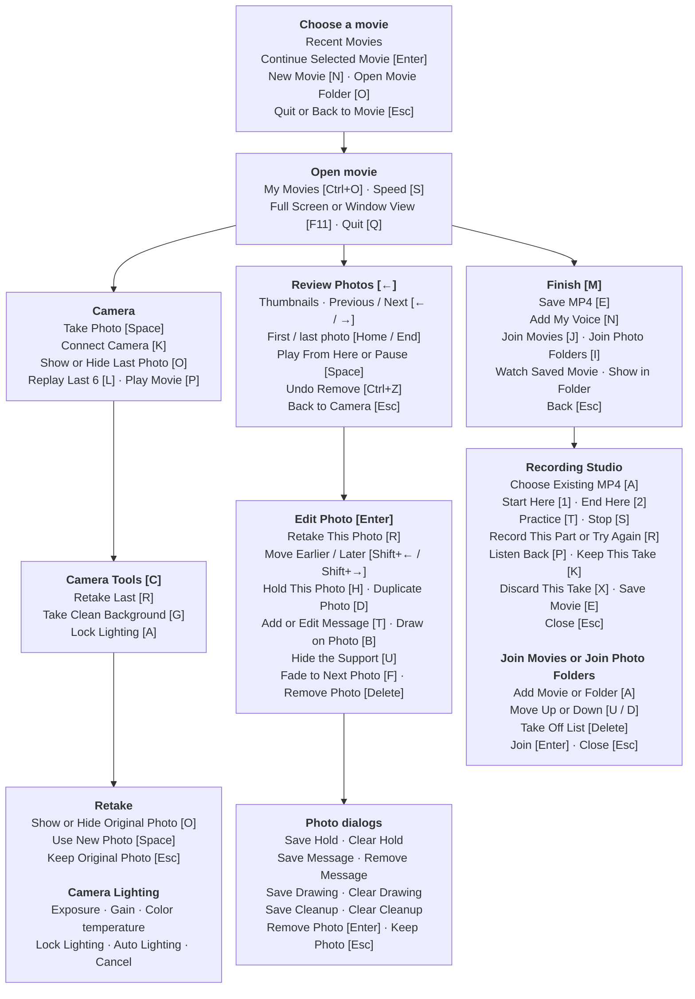

# StopActionPi menu diagram

Choose a movie, then use **Review Photos [←]** to move from Camera to Review and **Back to Camera [Esc]** to return. An existing movie opens in Review when the camera is disconnected. **Finish [M]** opens from either view. **My Movies [Ctrl+O]** takes you back to the movie picker. [Feature guide](FEATURES.md)

**Lock Lighting [A]** appears on the current Pi build. The feature guide describes camera support. [Camera Tools](FEATURES.md#camera-tools)
